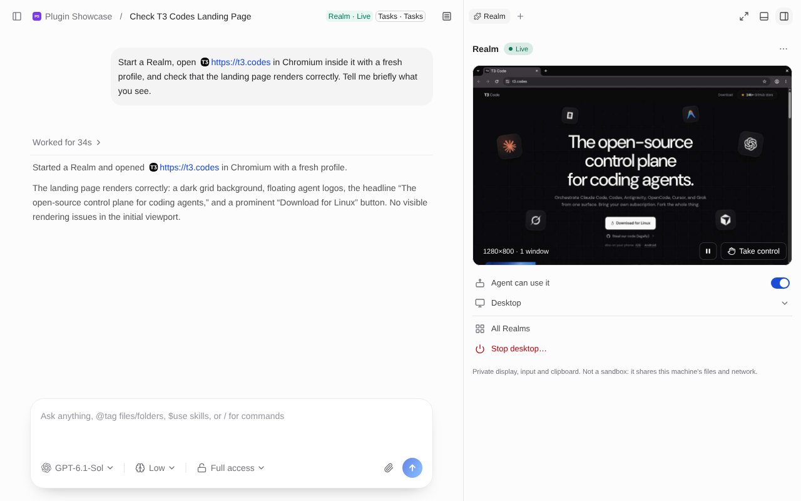
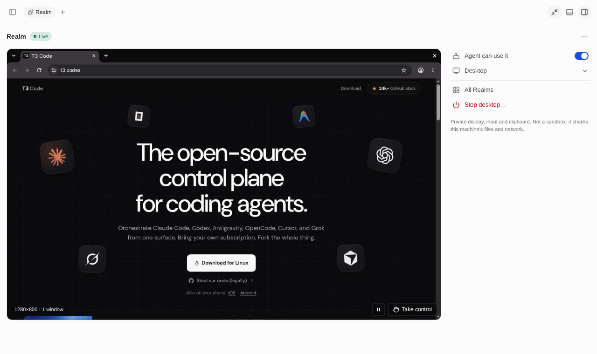
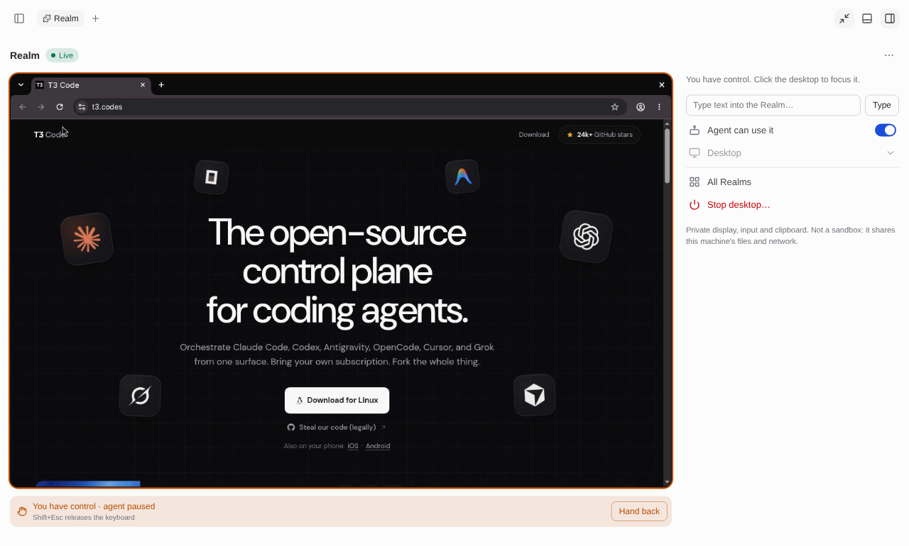

# T3 Code Realms

A [T3 Code](https://github.com/pingdotgg/t3code) plugin that gives a thread its own private Linux desktop. Agents can open, click and screenshot apps there without touching your screen, mouse or clipboard. You watch it live in a side panel, and you can take over any time.



## Two kinds of Realm

|  | **Desktop** (default) | **Omarchy VM** |
|---|---|---|
| What it is | A lightweight extra desktop (labwc) on the T3 server's machine | A full virtual machine running [Omarchy](https://omarchy.org) |
| Starts in | Seconds | Minutes the first time (downloads and installs Omarchy) |
| Isolation | Own windows, mouse, keyboard and clipboard, but **shares the machine's files and network** | Own kernel, disk and desktop. Files move only when you or the agent copy them in or out |
| Good for | Testing GUI apps and websites | Testing things you don't want touching your machine |

You choose the kind in the Realm panel, or the agent asks for one. A Desktop Realm is **not a sandbox**, so don't use it for code you don't trust.

## Requirements

On the machine running the T3 server:

- Linux x86-64 with systemd and Python 3.11+.
- **Desktop:** `labwc`, `Xwayland`, `wayvnc`, `grim`, `wlr-randr`, `bubblewrap`, D-Bus and AT-SPI.
- **Omarchy VM:** QEMU/KVM (`qemu-full`, `edk2-ovmf`, `mtools`), access to `/dev/kvm`, an `~/.ssh/id_ed25519` key, and about 46 GiB of free disk space.
- A T3 Code build with the newer plugin host (verified callers, plugin data directory, image results and thread status).

Setup tells you exactly what's missing. On Arch Linux it can install the missing packages for you after you approve.

## Install

1. In T3 Code, open **Settings → Plugins** and add `https://github.com/Zeus-Deus/t3code-realms.git`.
2. Review and approve it. Grant `ui`, `storage` and `settings`. You can also grant `threads.send` so a waiting agent picks up again once setup finishes.
3. Open **Realms** from the command palette and run setup.

## Using it

Ask the agent to test something visually, for example *"open my app in a Realm and check that the login page works"*. The agent starts the Realm itself.

The thread's details card then shows **Realm · Live**. Click it to open the Realm panel:

- **Take control** lets you use the desktop yourself. The agent pauses until you click **Hand back**.
- **Agent can use it** turns the agent's access to the Realm on or off. Only you can turn it back on.
- **Stop desktop** shuts it down. Its files are kept, so you can start it again later.
- **All Realms** lists every Realm. You can stop them there, or delete one you no longer need.

| Maximized panel | You have control |
|---|---|
|  |  |

## Good to know

- The agent's normal work (shell, files, git) is unchanged. Realms only adds tools.
- Sub-agents share their parent thread's Realm instead of starting their own.
- An idle Realm stops after 30 minutes, and its files are kept.
- The Omarchy VM's disk is unencrypted and has passwordless `sudo`, so keep tokens and personal files out of it.

## For agents

Agents find these through `t3_plugin_list` and call them with `t3_plugin_invoke`:

| Action | What it does |
|---|---|
| `realm` | Turn the thread's Realm on or off (`kind: "realm"` or `"omarchy-vm"`), check status, take a screenshot, stop or repair it. |
| `realm-terminal` | Run commands inside the Realm, for example to launch an app. |
| `realm-computer` | Click, type, scroll, read the accessibility tree and take screenshots. |
| `realm-files` | Copy files into or out of an Omarchy VM. |

Setup, recovery, VM safety, file copies and how sub-agents share a Realm are covered in [docs/details.md](docs/details.md).

## Development

```sh
node --test tests/
cd runtime && python3 -I -B -m unittest discover -s tests -v
```

Tests that start real desktops or VMs are opt-in (`T3REALMS_NATIVE=1`, `T3REALMS_NATIVE_VM=1`). Only run them in a throwaway environment.

## License

MIT. Realms is a port of [Hermes Realms](https://github.com/Zeus-Deus/hermes-realms). See [NOTICE.md](NOTICE.md) for credits and the components it downloads.
